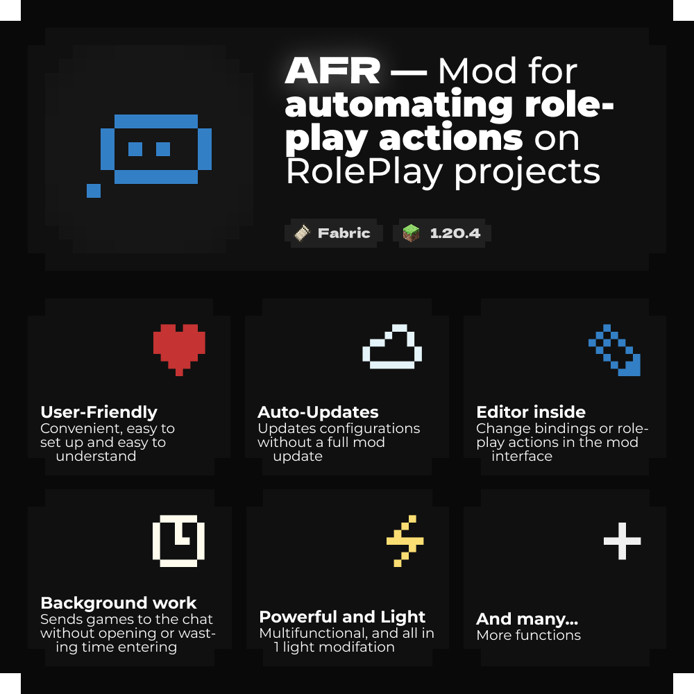

<div align="center">

**English** • [Русский](README.ru.md)

<p>
  <a href="https://github.com/Agzes/AFR/releases/latest"><kbd>⬇️ Download</kbd></a>
  &nbsp;·&nbsp;
  <a href="https://agzes.github.io/AFR/"><kbd>🌐 Website</kbd></a>
  &nbsp;·&nbsp;
  <!--
  <a href="docs/en/profile_creating.md"><kbd>📖 Docs</kbd></a>
  &nbsp;·&nbsp;
  <a href="https://agzes.github.io/go/to/discord"><kbd>💬 Discord</kbd></a>
  &nbsp;·&nbsp;
  -->
  <a href="https://github.com/Agzes/AFR/issues/new?template=bug_report.yml"><kbd>🐞 Bug</kbd></a>
  &nbsp;·&nbsp;
  <a href="https://github.com/Agzes/AFR/issues/new?template=feature_request.yml"><kbd>💡 Idea</kbd></a>
</p>

<h1>AFR</h1>



**Replaces the external AHK-FOR-RPM tool:** actions, delays, parameters and menus are described by configs and set up right in the game.

</div>

---

## > Installation

1. Install [Fabric Loader](https://fabricmc.net/use/) 0.14.23+ for Minecraft 1.20.4 and [Fabric API](https://modrinth.com/mod/fabric-api) 0.91.1+.
2. Install the [owo-lib](https://modrinth.com/mod/owo-lib) library 0.12.6+ - the mod will not start without it.
3. Put `afr-1.0.0.jar` into the `mods/` folder.
4. (Optional) install [Mod Menu](https://modrinth.com/mod/modmenu) to see the mod card and links in the mods list.
5. On first launch, complete the setup wizard (language, hotkeys, character) or open the editor with `/afr`, a button, or a bind.

Java 17+ is required to run the mod.

## > Variables

| Variable                                   | Meaning                |
| :----------------------------------------- | :--------------------- |
| `{Name}` / `{RPName}`                      | character RP name      |
| `{FirstName}` / `{LastName}`               | name parts             |
| `{Role}` / `{Position}`                    | role / position        |
| `{Param:id}` (or `{id}`)                   | profile parameter      |
| `{A\|B\|C}`                                | random variant         |
| `{Left} {Right} {Up} {Down} {Tab} {Space}` | special keys (pressed) |

## > Hotkeys

| Action        | Default                |
| :------------ | :--------------------- |
| Action menu   | <kbd>F9</kbd>          |
| Editor        | <kbd>Right Shift</kbd> |
| Quick actions | configured in binds    |

All binds are changed in the settings.

## > Build

```bash
./gradlew build          # build/libs/afr-1.0.0.jar
./gradlew runClient      # launch a test client
```

Requires JDK 25+ (the mod targets Java 17).

Dependencies are checked against `gradle/verification-metadata.xml`; the Gradle wrapper distribution is pinned by SHA-256. If a dependency is intentionally updated and verification fails, refresh the metadata:

```bash
./gradlew --write-verification-metadata sha256 build
```

Loom-generated artifacts (`remapped.*`, `net.minecraft`, mappings) are trusted in the metadata because they are produced locally from verified inputs.

Local test server for the config library (the web bundle already contains the API):

```bash
bash web/serve.sh
./gradlew runClient -PafrCloud=http://127.0.0.1:8000/api
```

## > Website and API

The ready web bundle lives in `web/` - landing, library API and config viewer:

```bash
bash web/serve.sh        # http://127.0.0.1:8000/
```

The site is published to `https://agzes.github.io/AFR/` by `.github/workflows/pages.yml`. The library catalog is generated from `web/api/configs/` with `python3 scripts/sync_library.py --write`; CI opens a pull request with the updated catalog. See [web/README.md](web/README.md) for details.

## > Docs

- [Profile guide](docs/en/profile_creating.md) - creating a profile: from empty to a publishing request.
- [CHANGELOG](CHANGELOG.md) - version history.
- [Privacy](.github/PRIVACY.md) - which network requests the mod makes.
- In-game tutorial: the "Tutorial" button in the editor.

## > Community

Questions or ideas? [Open an issue on GitHub](https://github.com/Agzes/AFR/issues/new/choose).

## > License

GPL-3.0-only. See [LICENSE](LICENSE).

---

<div align="center">

<kbd>With</kbd> <kbd>❤️</kbd> <kbd>by</kbd> <kbd>Agzes</kbd><br><kbd>pls ⭐ project!</kbd>

</div>
