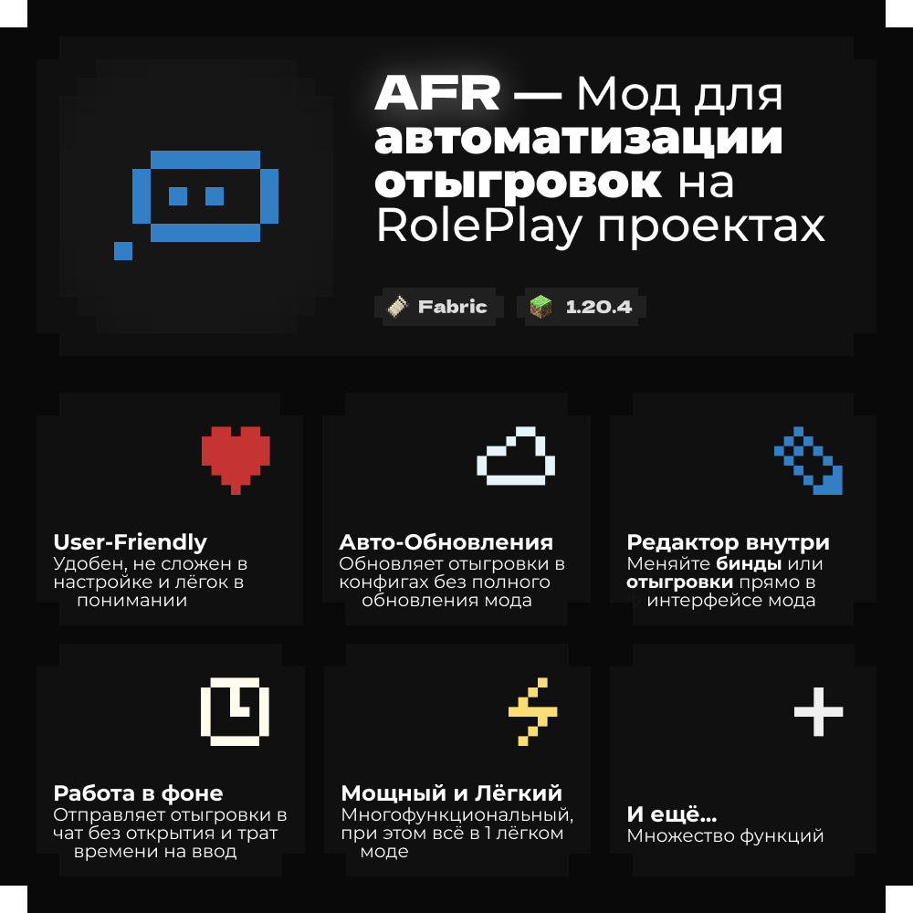

<div align="center">

[English](README.md) • **Русский**

<p>
  <a href="https://github.com/Agzes/AFR/releases/latest"><kbd>⬇️ Скачать</kbd></a>
  &nbsp;·&nbsp;
  <a href="https://agzes.github.io/AFR/"><kbd>🌐 Сайт</kbd></a>
  &nbsp;·&nbsp;
  <!-- 
  <a href="docs/ru/profile_creating.md"><kbd>📖 Документация</kbd></a>
  &nbsp;·&nbsp;
  <a href="https://agzes.github.io/go/to/discord"><kbd>💬 Discord</kbd></a>
  &nbsp;·&nbsp;
  -->
  <a href="https://github.com/Agzes/AFR/issues/new?template=bug_report.yml"><kbd>🐞 Баг</kbd></a>
  &nbsp;·&nbsp;
  <a href="https://github.com/Agzes/AFR/issues/new?template=feature_request.yml"><kbd>💡 Идея</kbd></a>
</p>

<h1>AFR</h1>



**Заменяет внешний AHK-FOR-RPM:** действия, задержки, параметры и меню описываются конфигами и настраиваются прямо в игре.

</div>

---

## > Установка

1. Установите [Fabric Loader](https://fabricmc.net/use/) 0.14.23+ для Minecraft 1.20.4 и [Fabric API](https://modrinth.com/mod/fabric-api) 0.91.1+.
2. Установите библиотеку [owo-lib](https://modrinth.com/mod/owo-lib) 0.12.6+ - без неё мод не запустится.
3. Положите `afr-1.0.0.jar` в папку `mods/`.
4. (Опционально) установите [Mod Menu](https://modrinth.com/mod/modmenu), чтобы видеть карточку мода и ссылки в списке модов.
5. При первом запуске пройдите мастер настройки (язык, хоткеи, персонаж) или откройте редактор командой `/afr`, кнопкой, или биндом.

Для запуска нужен Java 17+.

## > Переменные

| Переменная                                 | Значение                       |
| :----------------------------------------- | :----------------------------- |
| `{Name}` / `{RPName}`                      | имя персонажа                  |
| `{FirstName}` / `{LastName}`               | части имени                    |
| `{Role}` / `{Position}`                    | должность                      |
| `{Param:id}` (или `{id}`)                  | параметр профиля               |
| `{A\|B\|C}`                                | случайный вариант              |
| `{Left} {Right} {Up} {Down} {Tab} {Space}` | служебные клавиши (нажимаются) |

## > Горячие клавиши

| Действие         | По умолчанию           |
| :--------------- | :--------------------- |
| Меню действий    | <kbd>F9</kbd>          |
| Редактор         | <kbd>Right Shift</kbd> |
| Быстрые действия | настраиваются в биндах |

Все бинды меняются в настройках.

## > Сборка

```bash
./gradlew build          # build/libs/afr-1.0.0.jar
./gradlew runClient      # тестовый клиент
```

Для сборки нужен JDK 25+ (Gradle/Loom), а тестовый клиент запускается на JDK 21 (сам мод собирается под Java 17).

Зависимости проверяются по `gradle/verification-metadata.xml`; дистрибутив Gradle закреплён по SHA-256. Если зависимость обновлена намеренно и проверка падает, обновите метаданные:

```bash
./gradlew --write-verification-metadata sha256 build
```

Артефакты, которые генерирует Loom (`remapped.*`, `net.minecraft`, маппинги), помечены как trusted: они собираются локально из проверенных исходников.

Локальный сервер библиотеки (веб-бандл уже содержит API):

```bash
bash web/serve.sh
./gradlew runClient -PafrCloud=http://127.0.0.1:8000/api
```

## > Сайт и API

Готовый веб-бандл лежит в `web/` - лендинг, API библиотеки и просмотрщик конфигов:

```bash
bash web/serve.sh        # http://127.0.0.1:8000/
```

Сайт публикуется на `https://agzes.github.io/AFR/` через `.github/workflows/pages.yml`. Каталог библиотеки генерируется из папок `web/api/configs/` командой `python3 scripts/sync_library.py --write`; CI открывает PR с обновлённым каталогом. Подробности - в [web/README.ru.md](web/README.ru.md).

## > Документация

- [Гайд по профилям](docs/ru/profile_creating.md) - как создать профиль: от пустого до публикации.
- [CHANGELOG](CHANGELOG.ru.md) - история версий.
- [Конфиденциальность](.github/PRIVACY.ru.md) - какие сетевые запросы делает мод.
- Обучение внутри игры: кнопка «Обучение» в редакторе.

## > Сообщество

Есть вопрос или идея? [Создайте issue на GitHub](https://github.com/Agzes/AFR/issues/new/choose).

## > Лицензия

GPL-3.0-only. См. [LICENSE](LICENSE).

---

<div align="center">

<kbd>With</kbd> <kbd>❤️</kbd> <kbd>by</kbd> <kbd>Agzes</kbd><br><kbd>pls ⭐ project!</kbd>

</div>
